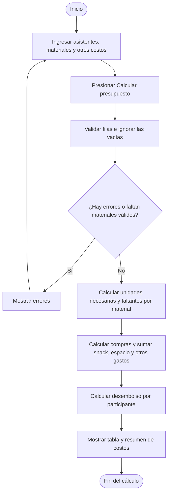

# 🎨 planificador_experiencias

## ¿Qué hace el aplicativo?

**Planificador de Experiencias Creativas** es un aplicativo académico desarrollado en **Python y Streamlit** que ayuda a preparar los materiales y el presupuesto de una experiencia, como un taller de pintura, velas o accesorios.

A partir del número de asistentes, los materiales que requiere cada persona y las existencias disponibles, calcula **cuántas unidades faltan comprar y cuánto dinero se necesita desembolsar**. También incorpora el refrigerio por persona, el costo del espacio y otros gastos.

El resultado permite organizar la lista de compras y conocer el desembolso total y por participante antes de realizar la actividad. Todos los valores monetarios se manejan en **pesos colombianos (COP)**.

> El presupuesto corresponde al dinero adicional que debes desembolsar. Los materiales que ya tienes disponibles no se vuelven a cobrar. Por eso, este resultado no representa necesariamente el costo económico completo de la experiencia ni el precio de venta de una entrada.

## Funciones principales

- Registrar el nombre de la experiencia y el número de asistentes.
- Agregar y eliminar filas de materiales mediante los botones de la interfaz.
- Indicar, para cada material, su nombre, existencias, unidades por participante y precio por unidad.
- Validar los materiales antes de calcular y mostrar los problemas encontrados.
- Calcular las unidades necesarias, las faltantes y el costo de compra de cada material.
- Sumar las compras, el snack de todos los asistentes, el espacio y los gastos adicionales.
- Mostrar una tabla de materiales y un resumen del desembolso total y por participante.

## Datos que solicita

| Dato | Descripción y condición |
| --- | --- |
| Nombre de la experiencia | Texto opcional. Se muestra en los resultados si se diligencia. |
| Número de asistentes | Número entero entre 1 y 10.000. Incluye a todas las personas para las que se presupuestan materiales y snack. |
| Nombre del material | Obligatorio en cada fila que tenga información. Se eliminan los espacios al inicio y al final al validar. |
| Unidades disponibles | Cantidad que ya tienes. Entero mayor o igual a 0. |
| Unidades por persona | Cantidad que necesita cada participante. Entero mayor o igual a 1. |
| Precio unitario | Precio de compra de una unidad del material. Entero mayor o igual a 0, en COP. |
| Snack por persona | Costo del refrigerio de una persona. Entero mayor o igual a 0, en COP. |
| Costo del espacio | Valor total del alquiler o reserva. Entero mayor o igual a 0, en COP. |
| Otros gastos | Valor total de los gastos adicionales. Entero mayor o igual a 0, en COP. |

**El precio del material se ingresa por unidad, no por paquete.** El aplicativo no calcula cuántos paquetes completos debes comprar.

### Validación de materiales

Al presionar **Calcular presupuesto**, el programa recorre las filas y aplica estas reglas:

1. Ignora una fila únicamente si conserva todos los valores iniciales: nombre vacío, disponibles = 0, unidades por persona = 1 y precio = 0.
2. Si una fila tiene información pero no tiene nombre, registra un error.
3. Verifica que las existencias y el precio no sean negativos y que las unidades por persona sean al menos 1. Los campos numéricos también restringen estos valores desde la interfaz.
4. Exige al menos un material válido. Una fila con nombre y precio de $0 puede ser válida.
5. Si encuentra errores, los muestra y no ejecuta el cálculo hasta que el usuario corrija los datos y vuelva a pulsar el botón.

## ¿Cómo calcula el presupuesto?

Para cada material:

```text
Unidades necesarias = asistentes × unidades por persona
Unidades faltantes  = máximo(unidades necesarias − disponibles, 0)
Costo de compra     = unidades faltantes × precio unitario
```

Después calcula:

```text
Compras de materiales      = suma de los costos de compra de todos los materiales
Total snack               = asistentes × snack por persona
Desembolso total          = compras de materiales + total snack + espacio + otros gastos
Desembolso por participante = desembolso total ÷ asistentes
```

Si las existencias cubren o superan lo necesario, las unidades faltantes y el costo de compra de ese material son **0**. El desembolso por participante es un promedio del presupuesto entre todos los asistentes.

## Uso paso a paso

1. Escribe el nombre de la experiencia, si deseas identificarla, e indica el número de asistentes.
2. Completa una fila por cada material. Usa **➕ Agregar material** para añadir filas o **🗑️** para eliminarlas.
3. Ingresa el snack por persona, el costo total del espacio y los demás gastos.
4. Presiona **🧮 Calcular presupuesto**.
5. Si aparecen errores, corrige las filas indicadas y vuelve a calcular.
6. Consulta la tabla con las cantidades necesarias, disponibles y faltantes, y el costo de compra de cada material.
7. Revisa los subtotales, el desembolso total y el valor promedio por participante.

## Seudocódigo del script

El siguiente seudocódigo resume la interfaz, la validación y los cálculos del archivo Python. Conserva el ciclo `MIENTRAS` para validar las filas y el ciclo `PARA` para calcular los materiales.

```text
INICIO
    CONFIGURAR página, colores, título e instrucciones
    LEER nombre_experiencia (opcional)
    LEER asistentes (entero entre 1 y 10000)

    SI la lista de materiales no existe en la sesión ENTONCES
        CREAR lista con una fila inicial:
            nombre = "", disponibles = 0, por_persona = 1, precio = 0
    FIN SI

    PARA CADA fila de la lista de materiales HACER
        MOSTRAR campos editables y GUARDAR sus valores en la sesión
        SI se presiona Eliminar ENTONCES
            ELIMINAR esa fila y VOLVER A EJECUTAR la interfaz
        FIN SI
    FIN PARA

    SI se presiona Agregar material ENTONCES
        AÑADIR una fila con los valores iniciales
        VOLVER A EJECUTAR la interfaz
    FIN SI

    LEER snack_por_persona, costo_espacio y otros_gastos
        (enteros mayores o iguales a 0)

    SI se presiona Calcular presupuesto ENTONCES
        materiales_validos ← lista vacía
        errores ← lista vacía
        i ← 0

        MIENTRAS i < cantidad de filas HACER
            OBTENER la fila i
            nombre ← nombre sin espacios al inicio y al final
            LEER disponibles, por_persona y precio como enteros

            SI nombre = "" Y disponibles = 0 Y por_persona = 1 Y precio = 0 ENTONCES
                IGNORAR la fila
            SINO SI nombre = "" ENTONCES
                AGREGAR error de nombre vacío
            SINO SI disponibles < 0 ENTONCES
                AGREGAR error de existencias negativas
            SINO SI por_persona < 1 ENTONCES
                AGREGAR error de unidades por persona
            SINO SI precio < 0 ENTONCES
                AGREGAR error de precio negativo
            SINO
                AGREGAR la fila a materiales_validos
            FIN SI

            i ← i + 1
        FIN MIENTRAS

        SI materiales_validos está vacío Y errores está vacío ENTONCES
            AGREGAR error: "Debes agregar al menos un material completo"
        FIN SI

        SI errores no está vacío ENTONCES
            MOSTRAR cada error sin realizar el cálculo
        SINO
            resultados ← lista vacía
            total_compras ← 0

            PARA CADA material EN materiales_validos HACER
                necesarias ← asistentes × material.por_persona
                diferencia ← necesarias − material.disponibles

                SI diferencia > 0 ENTONCES
                    faltantes ← diferencia
                SINO
                    faltantes ← 0
                FIN SI

                costo_compra ← faltantes × material.precio
                total_compras ← total_compras + costo_compra
                GUARDAR nombre, necesarias, disponibles, faltantes y costo_compra
                    en resultados
            FIN PARA

            total_snack ← asistentes × snack_por_persona
            desembolso_total ← total_compras + total_snack + costo_espacio + otros_gastos
            desembolso_por_persona ← desembolso_total ÷ asistentes

            SI nombre_experiencia no está vacío después de quitar espacios ENTONCES
                MOSTRAR nombre_experiencia
            FIN SI
            MOSTRAR asistentes y aclaración sobre el desembolso
            CREAR tabla de resultados con pandas
            MOSTRAR tabla y resumen de costos con formato de pesos colombianos
        FIN SI
    FIN SI

    MOSTRAR pie de página
FIN
```

Streamlit vuelve a ejecutar el script al interactuar con la interfaz. La lista de materiales utiliza `st.session_state` para conservar sus datos entre interacciones de la sesión. Los resultados se calculan al pulsar el botón correspondiente.

## Diagrama de flujo

El diagrama resume el proceso principal de presupuesto. La edición de filas se realiza en el paso de ingreso de datos; la revisión de cada fila está detallada en el seudocódigo.



> GitHub muestra este bloque como un diagrama visual al abrir el README. En un editor sin soporte para Mermaid se verá el código del diagrama.

## Ejemplo de uso: taller de velas

| Dato de entrada | Valor |
| --- | ---: |
| Asistentes | 18 |
| Material | Velas |
| Unidades disponibles | 20 |
| Unidades por persona | 7 |
| Precio por vela | $700 |
| Snack por persona | $22.000 |
| Costo del espacio | $80.000 |
| Otros gastos | $0 |

**Resultados esperados:**

| Resultado | Cálculo | Valor |
| --- | --- | ---: |
| Velas necesarias | 18 × 7 | 126 |
| Velas faltantes | 126 − 20 | 106 |
| Compra de velas | 106 × $700 | $74.200 |
| Total snack | 18 × $22.000 | $396.000 |
| Desembolso total | $74.200 + $396.000 + $80.000 + $0 | **$550.200** |
| Desembolso por participante | $550.200 ÷ 18 | **$30.566,67** |

Las 20 velas disponibles reducen la compra a 106 unidades. Su valor de adquisición anterior no se suma al desembolso calculado.

## Archivos y tecnologías

| Archivo | Función |
| --- | --- |
| `app.py` | Interfaz en Streamlit, validación de datos y cálculo del presupuesto. |
| `requirements.txt` | Dependencias: `streamlit>=1.32.0` y `pandas>=2.0.0`. |
| `README.md` | Descripción, instrucciones, seudocódigo, diagrama y ejemplo de uso. |

El script utiliza listas y diccionarios para organizar los materiales, condicionales para validar los datos, un ciclo `while` para revisar las filas y un ciclo `for` para calcular sus resultados. **pandas** construye la tabla que se presenta en pantalla.

## Instalación y ejecución local

Necesitas Python y pip instalados, en una versión compatible con las dependencias del proyecto.

1. Guarda los archivos en una misma carpeta. Para seguir los comandos de este README, utiliza los nombres `app.py`, `requirements.txt` y `README.md`. Si los archivos descargados tienen sufijos como `app(3).py` o `requirements(1).txt`, renómbralos o ajusta los comandos a esos nombres.
2. Abre una terminal en esa carpeta e instala las dependencias:

   ```bash
   python -m pip install -r requirements.txt
   ```

3. Ejecuta la aplicación:

   ```bash
   python -m streamlit run app.py
   ```

4. Abre la dirección local indicada en la terminal, normalmente `http://localhost:8501`.
5. Para cerrar el servidor, presiona **Ctrl + C** en la terminal.

## Alcance de esta versión

- La información se maneja durante la sesión; el script no guarda proyectos en archivos ni en una base de datos.
- Los resultados se consultan en pantalla; esta versión no incluye exportación a Excel o PDF.
- Calcula compras por unidades individuales, sin redondear a paquetes ni considerar descuentos de proveedores.
- No calcula ingresos, utilidad, punto de equilibrio ni precio de venta sugerido.
- El promedio por participante usa el total de asistentes ingresado; no distingue entre personas que pagan e invitadas.
